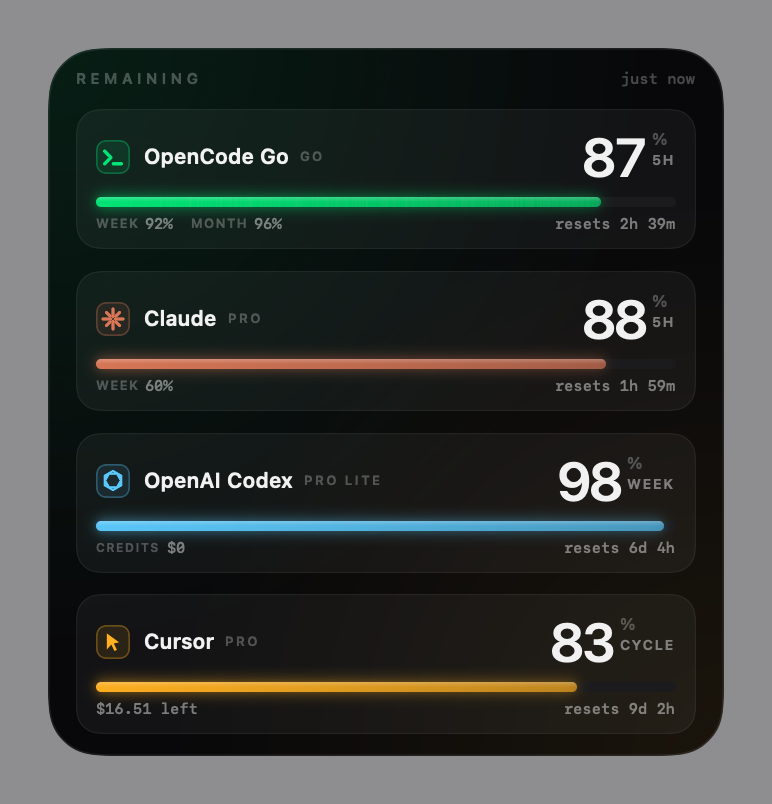
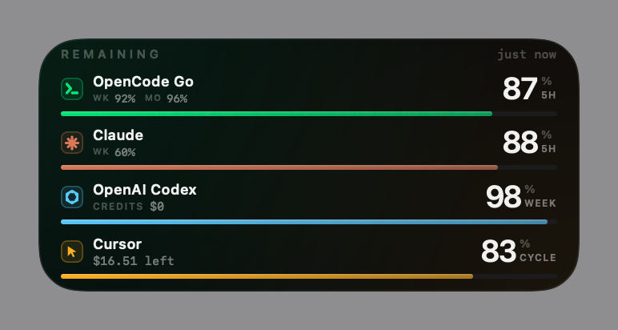
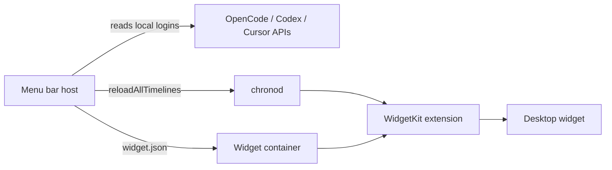

# Headroom

[Download the latest release](https://github.com/Drafffffff/headroom/releases/latest)

Native macOS and iOS widgets for the remaining budgets of **OpenCode Go**, **Anthropic Claude**, **OpenAI Codex** and **Cursor**.





## Features

- **OpenCode Go 5-hour budget is the primary metric.** Weekly and monthly remaining budgets sit beside it as a compact inline distribution — no extra progress bars.
- **Claude (Pro/Max)** shows its 5-hour session and weekly quotas, read from Claude Code's OAuth credentials.
- Four providers fit the same medium and large widget without extra bars.
- **One meter per provider**, filled by the *remaining* amount so the bar always matches the big number.
- **Menu bar host** fetches every 5 minutes (and after wake), writes a snapshot into the widget container, and asks WidgetKit to reload.
- **Tap a provider row** to open its usage dashboard; tapping the background launches the menu bar app.
- **Full-color and monochrome widget styles** are both supported (macOS 26 widget style).
- Native SwiftUI / WidgetKit. No Electron, no background web view.

## Requirements

- macOS 14 or later; desktop widgets require macOS 26.
- Swift 6 toolchain. Full Xcode is only needed to obtain an Apple signing certificate.
- **macOS 26 requires an Apple-issued certificate for widget extensions.** Ad-hoc and self-signed builds are rejected by `amfid` (`AppleMobileFileIntegrityError Code=-423`) and never appear in the gallery.

## Build and install

```bash
./build.sh      # compile host + widget extension, sign, package into dist/
./install.sh    # move the build to /Applications, register the extension, launch
```

If an `Apple Development` or `Developer ID Application` identity is present in the login keychain, `build.sh` signs with it automatically. To choose explicitly:

```bash
AIUSAGE_SIGN_IDENTITY="Apple Development: you@example.com (TEAMID)" ./build.sh
```

The build prints the team identifier and verifies the bundle. Without an Apple identity it falls back to ad-hoc and warns that the widget will not load.

### Certificate notes

- Free Apple ID: install Xcode, open **Settings → Accounts**, add the account, then **Manage Certificates → + → Apple Development**.
- If signing fails with `unable to build chain to self-signed root`, the Apple WWDR G3 intermediate is missing. Install [`AppleWWDRCAG3.cer`](https://www.apple.com/certificateauthority/AppleWWDRCAG3.cer) into the login keychain.
- The first `codesign` run may ask for keychain access; choose **Always Allow**.

## Add the widget

Right-click the desktop → **Edit Widgets** → search `Headroom` → drag the medium or large widget onto the desktop.

## iOS app

`ios/` contains a SwiftUI iPhone app that renders the same large widget layout. It does **not** store provider credentials: the menu-bar host writes the snapshot to iCloud Drive, and the iOS app reads it.

1. On the Mac, the host writes `~/Library/Mobile Documents/com~apple~CloudDocs/AIUsageWidget/widget.json` on every refresh.
2. Generate the project and open it:

```bash
cd ios && xcodegen generate && open AIUsageIOS.xcodeproj
```

3. Select the `AIUsageIOS` scheme and your iPhone, choose your team under Signing, and Run.
4. On first launch, tap the folder button and pick **iCloud Drive → AIUsageWidget**, or tap **Pick widget.json** and choose the file directly.
5. Add the home-screen widget: long-press the iPhone home screen → **+** → search **Headroom** → choose Medium or Large.

The app writes each successful snapshot into the shared App Group container, and the WidgetKit extension reads it. The widget and app share data through `group.com.drafff.aiusagewidget.ios`; both are signed with the same team.

The iOS app refreshes when foregrounded and supports pull-to-refresh. A free Apple ID can install it, but the signature expires after 7 days; re-run from Xcode to renew.

## Data sources

| Provider | Endpoint | Credential |
|---|---|---|
| OpenCode Go | `GET https://opencode.ai/zen/go/v1/usage` | API key from `~/Library/Application Support/AIUsageWidget/config.json`, `OPENCODE_API_KEY`, or `~/.local/share/opencode/auth.json` |
| Claude (Pro/Max) | `GET https://api.anthropic.com/api/oauth/usage` | Claude Code OAuth token from the macOS Keychain (`Claude Code-credentials`) or `~/.claude/.credentials.json` (read-only) |
| OpenAI Codex | `GET https://chatgpt.com/backend-api/wham/usage` | `~/.codex/auth.json` (read-only) |
| Cursor | `POST https://api2.cursor.sh/aiserver.v1.DashboardService/GetCurrentPeriodUsage` | Cursor `state.vscdb` session token (read-only) |

Credentials are only read. Nothing is uploaded or written back. If the Claude token has expired, open Claude Code once to refresh it; Headroom never writes to Claude's credentials. The OpenCode key is stored in `config.json` with directory permissions `0700` and file permissions `0600`.

## Updates and background behavior

The widget extension cannot fetch data on its own. It is sandboxed (required by `pluginkit`) and cannot read `~/.codex` or Cursor's database. The menu-bar host is the only process that fetches from the APIs.

| State | What happens |
|---|---|
| Host running | Fetches every 5 minutes and after wake, writes `widget.json`, calls `reloadAllTimelines()` |
| Host quit | Widget keeps the last snapshot and its age; its 30-minute timeline only re-reads the file |
| Network failure | Host keeps the previous snapshot (`widget-last-good.json`) and retries after 60 seconds |
| After reboot | Nothing starts until the host is launched — install the login item if you want automatic updates |

Enable autostart:

```bash
./autostart.sh install   # adds ~/Library/LaunchAgents/com.drafff.aiusagewidget.plist
./autostart.sh status
./autostart.sh remove
```

The host runs as a menu bar accessory: no Dock icon, no window, and automatic termination is disabled while it runs.

## Architecture



The extension is sandboxed (required by `pluginkit`) and cannot read `~/.codex` or Cursor's database. The host is unsandboxed: it fetches data and writes the same JSON to both its Application Support directory and the widget's container. The extension's `TimelineProvider` reads the container file.

The extension uses the same `_NSExtensionMain` entry point as an Xcode-built app extension, so it is launched correctly by ExtensionKit.

## Development

```bash
./build/AIUsageWidget --dump                     # live JSON for all providers
./build/AIUsageWidget --preview out --live       # render widget previews with live data
./build/AIUsageWidget --preview out              # sample data
./build/AIUsageWidget --preview out --mono       # monochrome variant
./build/AIUsageWidget --preview out --cached     # current container snapshot
./build/AIUsageWidget --widget-selftest          # inspect snapshot files
./build/AIUsageWidget --settings-preview s.png   # render settings panel
./build/AIUsageWidget --icon icon.png            # render 1024 app icon
```

## Notes

- These are unofficial endpoints and may change.
- The widget refreshes primarily through the host (`reloadAllTimelines`); the timeline itself falls back to a 30-minute refresh.
- Failed refreshes keep the previous snapshot (plus a `widget-last-good.json` fallback) and retry after 60 seconds, so a network outage never blanks the widget.
- Replacing or moving the app re-registers the extension. If a widget keeps rendering an old timeline, remove and re-add it.
- The host has no Dock icon and no window; use the menu bar gauge for **Refresh now**, **Settings**, **Open dashboard**, or **Quit**.
- Keep only one copy of the app registered. Building to `dist/` and installing to `/Applications` leaves two bundles with the same identifier; `install.sh` moves the build so the widget always resolves the installed copy.

## License

MIT
